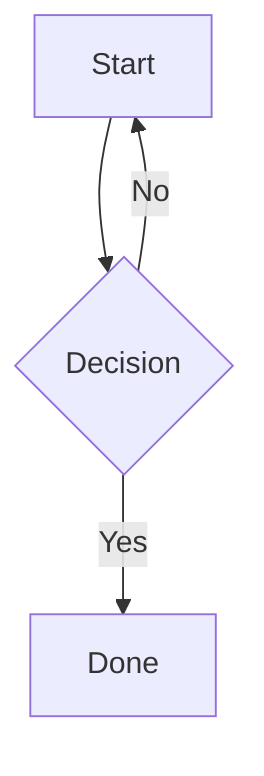
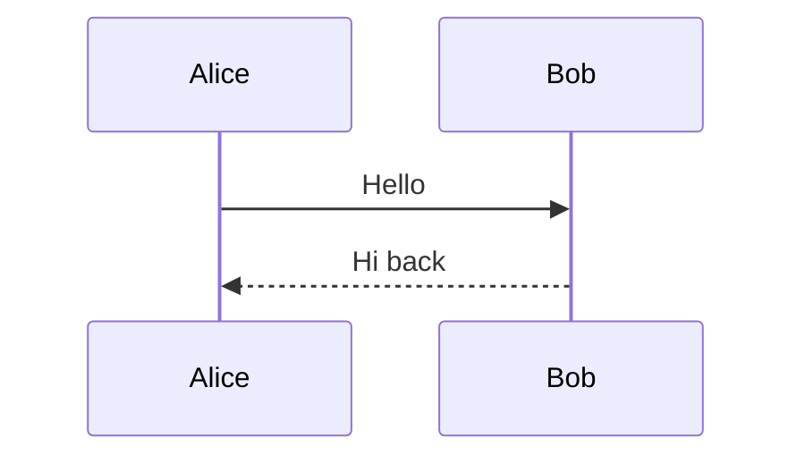
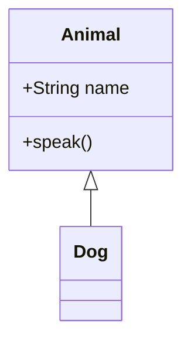
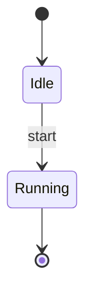
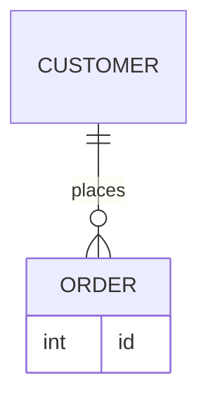
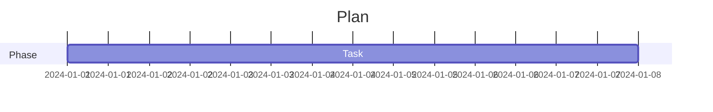
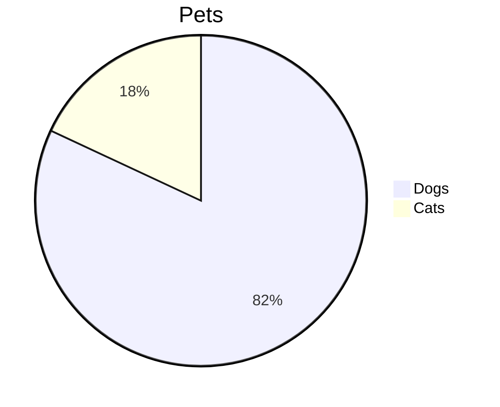
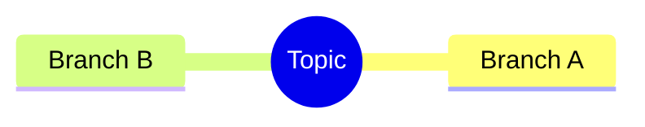

# Mermaid Diagrams

One diagram per supported starter template, for checking rendering in light and dark themes.

## Flowchart



## Sequence



## Class



## State



## Entity Relationship



## Gantt



## Pie



## Mindmap



## Intentionally invalid diagram

This one should show an error caption instead of a rendered diagram, and a lint marker in the editor.

```mermaid
flowchart TD
    A -->
```
